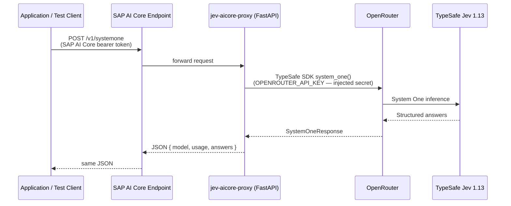

# jev-aicore-proxy

A lightweight FastAPI proxy that exposes TypeSafe Jev 1.13 (via OpenRouter) through an SAP AI Core managed inference endpoint.

This is a PoC. The goal is to verify that structured Jev System One inference can be reached through SAP AI Core before committing to a separate Jev subscription.

---

## Architecture



**Authentication boundaries:**
- The client authenticates to SAP AI Core with a bearer token obtained from your BTP XSUAA instance.
- The proxy authenticates to OpenRouter with the `OPENROUTER_API_KEY` injected as a Generic Secret by SAP AI Core at deployment time.
- The client never sees or needs the OpenRouter key.

---

## Project structure

```
jev-aicore-proxy/
├── server.py               FastAPI application
├── requirements.txt        Runtime dependencies (pinned)
├── Dockerfile              Container image definition
├── .dockerignore
├── .gitignore
├── .env.example            Placeholder for local development
├── pytest.ini
├── tests/
│   └── test_server.py      Unit tests (mocked) + integration test
└── deployment/
    └── jev-serving.yaml    SAP AI Core ServingTemplate
```

---

## Prerequisites

| Requirement | Notes |
|---|---|
| Python 3.12 | Tested with 3.12.14 |
| typesafe-sdk 0.7.5 | Installed from PyPI |
| OpenRouter API key | `OPENROUTER_API_KEY` |
| Docker (optional) | For container build |
| SAP AI Core access | For actual deployment |

---

## Local setup

```bash
# Clone / open the project
cd jev-aicore-proxy

# Install all dependencies (runtime + dev)
pip install -r requirements.txt pytest pytest-mock pytest-asyncio httpx

# Copy the example env file and add your key
cp .env.example .env
# Edit .env and set OPENROUTER_API_KEY=sk-or-v1-...
```

---

## Environment configuration

| Variable | Required | Description |
|---|---|---|
| `OPENROUTER_API_KEY` | Yes | OpenRouter API key for Jev model access |

The application refuses to start if the key is missing.

**Never commit `.env`** — it is listed in `.gitignore`.

---

## API endpoints

### `GET /v2/health`

Returns `{"status": "ok"}`. Does not call OpenRouter.

```bash
curl http://localhost:8080/v2/health
```

### `POST /v1/systemone`

Runs a Jev System One structured decision request.

**Request body:**

```json
{
  "state": {
    "customer_tier": "enterprise",
    "ticket": "Checkout page shows blank screen after clicking Pay."
  },
  "questions": {
    "is_bug": {
      "type": "noul",
      "instructions": "Is the customer reporting a software defect?",
      "criteria": {
        "true": "The product behaves unexpectedly.",
        "false": "The customer is asking a question or requesting a feature."
      }
    },
    "team": {
      "type": "choice",
      "instructions": "Which team should own this ticket?",
      "criteria": {
        "payments": "Checkout, billing, or payment processing issues.",
        "frontend": "Rendering, layout, or browser compatibility issues.",
        "account": "Login, permissions, or profile issues."
      }
    },
    "urgency": {
      "type": "score",
      "instructions": "How urgent is this ticket?",
      "criteria": [
        "Can wait for the next release",
        "Should be fixed this week",
        "Blocking revenue right now"
      ]
    }
  }
}
```

**Example curl:**

```bash
curl -s -X POST http://localhost:8080/v1/systemone \
  -H "Content-Type: application/json" \
  -d @- <<'EOF'
{
  "state": {"customer_tier": "enterprise", "ticket": "Blank screen after Pay click."},
  "questions": {
    "is_bug": {"type": "noul", "instructions": "Software defect?",
               "criteria": {"true": "Unexpected behavior.", "false": "Feature request."}}
  }
}
EOF
```

**Response shape:**

```json
{
  "model": "jev-1.13",
  "usage": {"input_tokens": 42, "output_tokens": null},
  "answers": {
    "is_bug": {"type": "noul", "noul": 0.97},
    "team":   {"type": "choice", "choice": "frontend", "confidence": 0.91,
               "probabilities": {"payments": 0.05, "frontend": 0.91, "account": 0.04}},
    "urgency":{"type": "score", "score": 1.7, "confidence": 0.85,
               "legend": {"0": "Can wait", "1": "This week", "2": "Blocking revenue"},
               "probabilities": {"0": 0.05, "1": 0.50, "2": 0.45}}
  }
}
```

**Answer types:**

| Type | Key fields |
|---|---|
| `noul` | `noul` (float 0–1, probability of true/yes) |
| `choice` | `choice` (string), `confidence`, `probabilities` |
| `score` | `score` (float), `confidence`, `legend`, `probabilities` |

**HTTP status codes:**

| Code | Meaning |
|---|---|
| 200 | Success |
| 422 | Invalid request body (missing `state` or `questions`, wrong types) |
| 413 | Request body exceeds 64 KB limit |
| 502 | Upstream OpenRouter / Jev error |
| 503 | Proxy not ready (SDK client unavailable) |

---

## Running tests

```bash
# Unit tests only (no OpenRouter calls, no credits spent)
pytest tests/test_server.py -v -m "not integration"

# Integration test (real inference — costs credits)
OPENROUTER_API_KEY=sk-or-v1-... pytest tests/test_server.py -m integration -v
```

---

## Starting the server locally

```bash
OPENROUTER_API_KEY=sk-or-v1-... uvicorn server:app --host 0.0.0.0 --port 8080 --reload
```

Or load from `.env`:

```bash
# With python-dotenv pre-load via a helper
export $(grep -v '^#' .env | xargs) && uvicorn server:app --port 8080
```

---

## Building the Docker image

```bash
# Build
docker build -t jev-proxy:1.0.0 .

# Tag for GHCR
docker tag jev-proxy:1.0.0 ghcr.io/i780801/jev-proxy:1.0.0

# Smoke-test the container locally (host port 8081 if 8080 is in use)
docker run --rm -e OPENROUTER_API_KEY=sk-or-v1-... -p 8081:8080 jev-proxy:1.0.0

# Authenticate to GHCR (PAT needs write:packages scope)
echo "<your-ghcr-pat>" | docker login ghcr.io -u i780801 --password-stdin

# Push
docker push ghcr.io/i780801/jev-proxy:1.0.0
```

**Image pushed:** `ghcr.io/i780801/jev-proxy:1.0.0`
Digest: `sha256:d2e475d5f8803369f909b0a714b8d610084565de9e3d97a7fe6031114bc5db48`
Visibility: private (GHCR default — readable by SAP AI Core once the pull secret is registered)

---

## SAP AI Core deployment

> **These steps require your explicit confirmation before execution.**
> No commands below have been run automatically.

### 1. Obtain your SAP AI Core bearer token

```bash
curl -s -X POST "$AICORE_AUTH_URL/oauth/token" \
  -H "Content-Type: application/x-www-form-urlencoded" \
  -d "grant_type=client_credentials" \
  -d "client_id=$AICORE_CLIENT_ID" \
  -d "client_secret=$AICORE_CLIENT_SECRET" \
  | jq -r .access_token
```

Store the result as `AICORE_TOKEN`.

### 2. Create the OpenRouter Generic Secret

Base64-encode your key (no trailing newline):

```bash
echo -n "sk-or-v1-YOUR_KEY" | base64
```

Then create the secret:

```bash
curl -s -X POST "$AICORE_BASE_URL/v2/admin/secrets" \
  -H "Authorization: Bearer $AICORE_TOKEN" \
  -H "AI-Resource-Group: $AICORE_RG" \
  -H "Content-Type: application/json" \
  -d '{
    "name": "openrouter-key",
    "data": {
      "OPENROUTER_API_KEY": "<base64-encoded key>"
    }
  }'
```

### 3. Register the GHCR pull secret in SAP AI Core

The image is at `ghcr.io/i780801/jev-proxy:1.0.0` (private). SAP AI Core needs a pull secret to fetch it.

You need a GitHub PAT with **`read:packages`** scope (a separate, narrower token from the push token).

```bash
curl -s -X POST "$AICORE_BASE_URL/v2/admin/dockerRegistrySecrets" \
  -H "Authorization: Bearer $AICORE_TOKEN" \
  -H "Content-Type: application/json" \
  -d '{
    "name": "ghcr-secret",
    "data": {
      "ghcr.io": {
        "username": "i780801",
        "password": "<GitHub PAT with read:packages scope>"
      }
    }
  }'
```

### 4. Register a Git repository and sync the ServingTemplate

```bash
# Register your repo
curl -s -X POST "$AICORE_BASE_URL/v2/admin/repositories" \
  -H "Authorization: Bearer $AICORE_TOKEN" \
  -H "Content-Type: application/json" \
  -d '{
    "name": "jev-aicore-proxy",
    "url": "'"$GIT_REPO_URL"'",
    "username": "<git-user>",
    "password": "<git-token>"
  }'

# Create an Application (GitOps sync)
curl -s -X POST "$AICORE_BASE_URL/v2/admin/applications" \
  -H "Authorization: Bearer $AICORE_TOKEN" \
  -H "Content-Type: application/json" \
  -d '{
    "applicationName": "jev-proxy-app",
    "repositoryUrl": "'"$GIT_REPO_URL"'",
    "revision": "HEAD",
    "path": "deployment"
  }'
```

Wait for the sync; verify the scenario and executable are visible:

```bash
curl -s "$AICORE_BASE_URL/v2/lm/scenarios" \
  -H "Authorization: Bearer $AICORE_TOKEN" \
  -H "AI-Resource-Group: $AICORE_RG" | jq
```

### 5. Create a configuration and start the deployment

```bash
# Create configuration
CONFIG_ID=$(curl -s -X POST "$AICORE_BASE_URL/v2/lm/configurations" \
  -H "Authorization: Bearer $AICORE_TOKEN" \
  -H "AI-Resource-Group: $AICORE_RG" \
  -H "Content-Type: application/json" \
  -d '{
    "name": "jev-proxy-config",
    "executableId": "jev-proxy-serving",
    "scenarioId": "jev-proxy",
    "versionId": "1.0.0",
    "parameterBindings": [],
    "inputArtifactBindings": []
  }' | jq -r .id)

echo "Config ID: $CONFIG_ID"

# Create the deployment
DEPLOYMENT_ID=$(curl -s -X POST "$AICORE_BASE_URL/v2/lm/deployments" \
  -H "Authorization: Bearer $AICORE_TOKEN" \
  -H "AI-Resource-Group: $AICORE_RG" \
  -H "Content-Type: application/json" \
  -d '{"configurationId": "'"$CONFIG_ID"'"}' | jq -r .id)

echo "Deployment ID: $DEPLOYMENT_ID"
```

### 6. Wait for RUNNING status and get the inference URL

```bash
curl -s "$AICORE_BASE_URL/v2/lm/deployments/$DEPLOYMENT_ID" \
  -H "Authorization: Bearer $AICORE_TOKEN" \
  -H "AI-Resource-Group: $AICORE_RG" | jq '{status: .status, deploymentUrl: .deploymentUrl}'
```

Wait until `status` is `RUNNING`.

### 7. Call the deployed endpoint

```bash
INFERENCE_URL="<deploymentUrl from step 6>"

# Health check
curl -s "$INFERENCE_URL/v2/health" \
  -H "Authorization: Bearer $AICORE_TOKEN" \
  -H "AI-Resource-Group: $AICORE_RG"

# System One inference
curl -s -X POST "$INFERENCE_URL/v1/systemone" \
  -H "Authorization: Bearer $AICORE_TOKEN" \
  -H "AI-Resource-Group: $AICORE_RG" \
  -H "Content-Type: application/json" \
  -d '{
    "state": {"customer_tier": "enterprise", "ticket": "Blank screen after Pay click."},
    "questions": {
      "is_bug": {"type": "noul", "instructions": "Software defect?",
                 "criteria": {"true": "Unexpected behavior.", "false": "Feature request."}}
    }
  }'
```

---

## Known limitations and troubleshooting

| Symptom | Cause / Fix |
|---|---|
| Container exits immediately | `OPENROUTER_API_KEY` is missing — check secret injection |
| `POST /v1/systemone` → 502 | OpenRouter returned an error; check logs with `kubectl logs` or AI Core log API |
| `422 Unprocessable Entity` | Request body missing `state` or `questions`, or wrong JSON types |
| ServingTemplate not found | Git sync may still be pending — check Application status |
| `401` from SAP AI Core | Bearer token expired — re-obtain with `oauth/token` |
| Image pull failure | Docker registry secret not registered, or wrong name in YAML |

---

## Cost considerations

- **OpenRouter / Jev:** Each `POST /v1/systemone` call consumes Jev credits through OpenRouter. Unit tests mock the SDK and spend no credits. Only integration tests (`-m integration`) make real calls.
- **SAP AI Core:** Deployed containers accrue compute charges even when idle (running but receiving no traffic). Stop the deployment when not needed:
  ```bash
  curl -s -X PATCH "$AICORE_BASE_URL/v2/lm/deployments/$DEPLOYMENT_ID" \
    -H "Authorization: Bearer $AICORE_TOKEN" \
    -H "AI-Resource-Group: $AICORE_RG" \
    -H "Content-Type: application/json" \
    -d '{"targetStatus": "STOPPED"}'
  ```

---

## PoC scope and limitations

- This is a testing PoC, not a production service.
- No fallback model, no authentication on the internal container, no database, no queue.
- The proxy is stateless. Horizontal scaling is possible but not configured here.
- SAP AI Core deployment status is **not yet verified end-to-end** — the deployment YAML is prepared with correct schema based on published documentation, but an actual deployment and live inference test has not been executed.
